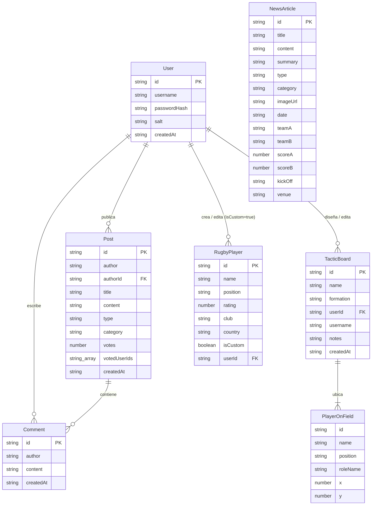

# Documentación de la Base de Datos — RugbyUnion

Este documento detalla la arquitectura, el modelo de datos, la persistencia y las operaciones del sistema de almacenamiento de **RugbyUnion**.

---

## 1. Arquitectura y Mecanismo de Persistencia

El almacenamiento de RugbyUnion está implementado como una base de datos documental embebida basada en un archivo plano JSON (`db.json`) gestionado por el módulo [`server/utils/db.ts`](../server/utils/db.ts).

### Características Principales:
- **Almacenamiento Local en Archivo:** Los datos residen en `db.json` en la raíz del proyecto.
- **Caché en Memoria:** Mantiene una referencia en memoria (`dbCache`) para agilizar lecturas subsecuentes sin sobrecargar el disco.
- **Escritura Síncrona:** Las mutaciones (creación, edición y borrado) actualizan el estado en memoria e inmediatamente escriben en disco (`fs.writeFileSync`).
- **Autoinicialización:** Si `db.json` no existe al iniciar la aplicación, el sistema crea automáticamente el archivo con la estructura por defecto (`DEFAULT_DB`), incluyendo noticias precargadas, jugadores de clase mundial y debates del foro iniciales.

---

## 2. Esquema General de Datos (`DatabaseSchema`)

La base de datos se estructura en cinco colecciones raíz:

```typescript
interface DatabaseSchema {
  users: User[];
  posts: Post[];
  news: NewsArticle[];
  players: RugbyPlayer[];
  tactics: TacticBoard[];
}
```



---

## 3. Detalle de Colecciones y Modelos

### 3.1. Usuarios (`users: User[]`)
Almacena las credenciales y metadatos de los usuarios registrados.

| Campo | Tipo | Requerido | Descripción |
|---|---|---|---|
| `id` | `string` | Sí | Identificador único (`user-{timestamp}-{random}`). |
| `username` | `string` | Sí | Nombre de usuario único (normalizado en minúsculas para validación). |
| `passwordHash` | `string` | Sí | Hash criptográfico generado mediante HMAC-SHA256 con salt. |
| `salt` | `string` | Sí | Cadena aleatoria hexadecimal generada por usuario. |
| `createdAt` | `string` | Sí | Timestamp ISO 8601 del registro. |

### 3.2. Publicaciones del Foro (`posts: Post[]`)
Debates y análisis tácticos compartidos por la comunidad.

| Campo | Tipo | Requerido | Descripción |
|---|---|---|---|
| `id` | `string` | Sí | Identificador único (`post-{timestamp}-{random}`). |
| `author` | `string` | Sí | Nombre de usuario del autor. |
| `authorId` | `string` | Opcional | ID del usuario autor (`User.id`). |
| `title` | `string` | Sí | Título descriptivo de la publicación. |
| `content` | `string` | Sí | Cuerpo del mensaje o análisis. |
| `type` | `"general" \| "analysis"` | Sí | Clasificación del contenido. |
| `category` | `"news" \| "tactics" \| "transfers" \| "general"` | Sí | Categoría temática. |
| `votes` | `number` | Sí | Conteo neto de votos positivos. |
| `votedUserIds` | `string[]` | Sí | Listado de IDs de usuarios que han votado (evita votos duplicados). |
| `comments` | `Comment[]` | Sí | Comentarios anidados en la publicación. |
| `createdAt` | `string` | Sí | Timestamp ISO 8601 de publicación. |

#### Sub-documento `Comment`:
- `id`: Identificador único (`c-{timestamp}-{random}`).
- `author`: Nombre de usuario del autor.
- `content`: Texto del comentario.
- `createdAt`: Timestamp ISO 8601.

### 3.3. Noticias y Partidos (`news: NewsArticle[]`)
Noticias, resultados y calendario de partidos de rugby internacional.

| Campo | Tipo | Requerido | Descripción |
|---|---|---|---|
| `id` | `string` | Sí | Identificador único (`news-{id}`). |
| `title` | `string` | Sí | Titular de la noticia. |
| `content` | `string` | Sí | Texto completo de la crónica. |
| `summary` | `string` | Sí | Resumen corto para tarjetas y vista previa. |
| `type` | `"international" \| "match_result" \| "upcoming"` | Sí | Tipo de entrada de noticias. |
| `category` | `string` | Sí | Torneo o categoría (e.g. "Seis Naciones", "Rugby Championship"). |
| `imageUrl` | `string` | Opcional | URL opcional a imagen de portada. |
| `date` | `string` | Sí | Fecha y hora del evento/noticia. |
| `teamA` / `teamB` | `string` | Opcional | Nombres de equipos en partidos y resultados. |
| `scoreA` / `scoreB` | `number` | Opcional | Marcador final en `match_result`. |
| `kickOff` | `string` | Opcional | Información de horario para `upcoming`. |
| `venue` | `string` | Opcional | Estadio o sede del encuentro. |

### 3.4. Jugadores (`players: RugbyPlayer[]`)
Catálogo de jugadores estándar de clase mundial y jugadores personalizados creados por usuarios.

| Campo | Tipo | Requerido | Descripción |
|---|---|---|---|
| `id` | `string` | Sí | ID (`p1..p18` para predefinidos, `player-custom-...` para propios). |
| `name` | `string` | Sí | Nombre completo del jugador. |
| `position` | `string` | Sí | Posición principal reglamentaria (Pilar, Talonador, Segunda línea, Flanker, Número 8, Medio melé, Apertura, Centro, Extremo, Zaguero). |
| `rating` | `number` | Sí | Valoración numérica de 1 a 99 (OVR). |
| `club` | `string` | Sí | Club o equipo del jugador (por defecto "Sin club"). |
| `country` | `string` | Sí | Selección o país de origen (por defecto "Selección"). |
| `isCustom` | `boolean` | Sí | `false` si es predeterminado global, `true` si es creado por un usuario. |
| `userId` | `string` | Opcional | ID del creador cuando `isCustom === true` (garantiza aislamiento y permisos de edición). |

### 3.5. Tableros Tácticos (`tactics: TacticBoard[]`)
Pizarras y formaciones tácticas creadas y guardadas por los usuarios.

| Campo | Tipo | Requerido | Descripción |
|---|---|---|---|
| `id` | `string` | Sí | Identificador único (`board-{timestamp}-{random}`). |
| `name` | `string` | Sí | Nombre asignado a la pizarra táctica. |
| `formation` | `"15-union" \| "7-sevens" \| "custom"` | Sí | Modalidad de rugby. |
| `playersOnField` | `Array<PlayerOnField>` | Sí | Jugadores posicionados en la cancha (coordenadas relativas). |
| `userId` | `string` | Sí | ID del usuario propietario. |
| `username` | `string` | Sí | Nombre del usuario propietario. |
| `notes` | `string` | Opcional | Notas o instrucciones tácticas del entrenador. |
| `createdAt` | `string` | Sí | Timestamp ISO 8601 de creación. |

#### Estructura de `PlayerOnField`:
- `id`: Identificador de referencia al jugador.
- `name`: Nombre del jugador.
- `position`: Posición base del jugador.
- `roleName`: Rol específico en cancha (e.g., "Pilar Izquierdo", "Apertura", "Zaguero").
- `x`: Porcentaje horizontal sobre el campo de juego (`0` a `100`).
- `y`: Porcentaje vertical sobre el campo de juego (`0` a `100`).

---

## 4. API Interna de Acceso a Datos

El archivo [`server/utils/db.ts`](../server/utils/db.ts) provee dos métodos centrales de acceso:

1. `getDB(): DatabaseSchema`:
   - Lee desde memoria si existe `dbCache`.
   - Si no existe el archivo, crea el directorio y el archivo `db.json` con los valores por defecto.
   - Si el archivo existe, lo lee y parsea, garantizando la existencia de todos los arreglos fundamentales (`users`, `posts`, `news`, `players`, `tactics`).
2. `saveDB(data: DatabaseSchema): void`:
   - Actualiza la variable en memoria `dbCache`.
   - Serializa y escribe en disco con formato legible (`JSON.stringify(data, null, 2)`).

---

## 5. Ciclo de Vida y Permisos sobre Datos

- **Aislamiento de Jugadores Personalizados:** Las consultas a `/api/tactics/players` filtran por `userId`, de modo que cada usuario solo ve sus propios jugadores sumados a los globales.
- **Edición Segura (`PUT /api/tactics/players/:id`):** Valida que el jugador a modificar sea propiedad del usuario logueado (`player.userId === user.id && player.isCustom`).
- **Seguridad en Tableros (`POST /api/tactics/boards` con `id`):** Al actualizar un tablero existente, se valida que `board.userId === user.id`; de lo contrario, se rechaza con error 403.
