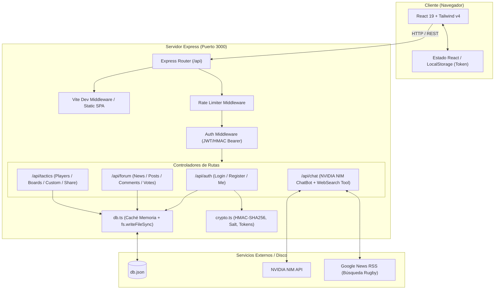

# Documentación Técnica — OnRugby

Especificación de arquitectura, diseño de componentes, capas del servidor, autenticación y endpoints de la plataforma **OnRugby**.

---

## 1. Visión General de la Arquitectura

OnRugby está estructurado bajo una arquitectura de monorepo monolítico ligero con separación clara entre interfaz de usuario y capa de servicios API:

- **Frontend:** Single Page Application (SPA) construida con **React 19**, **TypeScript** y **Tailwind CSS v4**, empaquetada con **Vite**.
- **Backend:** Servidor **Node.js** con **Express 4** en TypeScript, sirviendo tanto las rutas REST `/api/*` como los middlewares de desarrollo de Vite (o estáticos en producción).
- **IA / LLM:** Integración con **NVIDIA NIM** (modelo `nvidia/nemotron-3.5-bolt-e4b`) con capacidades de **Tool Calling** y **búsqueda web en vivo** (Google News RSS fallback) para el asistente técnico de rugby.
- **Capa de Datos:** Persistencia documental en archivo JSON local (`db.json`) libre de dependencias externas.



---

## 2. Pila Tecnológica (Tech Stack)

| Componente | Tecnología | Versión | Rol |
|---|---|---|---|
| Runtime | Node.js | >= 18 | Entorno de ejecución en servidor |
| Lenguaje | TypeScript | ~5.8.2 | Tipado estático de punta a punta |
| Backend Server | Express | ^4.21.2 | Servidor HTTP y orquestador de APIs |
| Bundler / DevServer | Vite | ^6.2.3 | Servidor dev ultrarrápido y bundler SPA |
| Compilador TS Server | tsx / esbuild | ^4.21.0 / ^0.25.0 | Ejecución directa y empaquetado del backend |
| UI Framework | React | ^19.0.1 | Librería declarativa de interfaces de usuario |
| Estilos | Tailwind CSS | ^4.1.14 | Motor de utilidades CSS moderno |
| Iconografía | Lucide React | ^0.546.0 | Conjunto de iconos vectoriales |
| Animaciones | Motion | ^12.23.24 | Animaciones fluidas de UI |
| Asistente IA | NVIDIA NIM | API REST | Respuestas tácticas, reglas y Tool Calling |

---

## 3. Seguridad y Autenticación

### 3.1. Hashing de Contraseñas y Salting
En [`server/utils/crypto.ts`](../server/utils/crypto.ts):
- Cada usuario registrado recibe una `salt` criptográfica generada con `crypto.randomBytes(16).toString("hex")`.
- La contraseña se hashea aplicando HMAC-SHA256 sobre la contraseña y la sal:
  $$\text{passwordHash} = \text{HMAC-SHA256}(\text{salt}, \text{password})$$
- No se almacenan contraseñas en texto claro.

### 3.2. Mecanismo de Tokens Bearer
- La sesión se firma generando un token serializado en Base64 con payload (`id`, `username`, `timestamp`) y firma criptográfica HMAC-SHA256 utilizando una clave secreta (`JWT_SECRET` o fallback interno).
- El cliente almacena el token en `localStorage` bajo la clave `onrugby_token`.
- En cada solicitud autenticada, el cliente envía la cabecera `Authorization: Bearer <token>`.

### 3.3. Rate Limiting Dinámico
El middleware [`server/middleware/rateLimiter.ts`](../server/middleware/rateLimiter.ts) protege contra abusos e intentos de fuerza bruta mediante una ventana deslizante basada en IP:
- **Rutas de Autenticación (`/api/auth/*`):** Máximo 5 solicitudes por ventana de 10 segundos.
- **Ruta de Chat Asistente (`/api/chat`):** Máximo 12 solicitudes por ventana de 60 segundos.

---

## 4. Especificación de la API REST

### 4.1. Autenticación (`/api/auth`)

#### `POST /api/auth/register`
Registra un nuevo usuario.
- **Body:** `{ "username": string, "password": string }`
- **Validaciones:** Usuario $\ge 3$ caracteres, contraseña $\ge 6$ caracteres, nombre disponible.
- **Respuesta (201):** `{ message: string, token: string, user: { id: string, username: string } }`

#### `POST /api/auth/login`
Autentica credenciales existentes.
- **Body:** `{ "username": string, "password": string }`
- **Respuesta (200):** `{ message: string, token: string, user: { id: string, username: string } }`

#### `GET /api/auth/me`
Verifica y devuelve los datos de la sesión actual.
- **Cabecera requerida:** `Authorization: Bearer <token>`
- **Respuesta (200):** `{ user: { id: string, username: string, createdAt: string } }`

---

### 4.2. Foro y Noticias (`/api/forum`)

#### `GET /api/forum/news`
Retorna la lista de artículos, resultados de partidos y encuentros programados.
- **Respuesta (200):** `{ news: NewsArticle[] }`

#### `GET /api/forum/posts`
Devuelve las publicaciones del foro ordenadas por fecha de creación descendente.
- **Respuesta (200):** `{ posts: Post[] }`

#### `POST /api/forum/posts` *(Requiere Auth)*
Crea un nuevo tema o análisis táctico.
- **Body:** `{ "title": string, "content": string, "type": "general" | "analysis", "category": "news" | "tactics" | "transfers" | "general" }`
- **Respuesta (201):** `{ message: string, post: Post }`

#### `POST /api/forum/posts/:id/vote` *(Requiere Auth)*
Alterna el voto positivo (upvote) del usuario autenticado en una publicación.
- **Respuesta (200):** `{ message: string, votes: number, hasVoted: boolean }`

#### `POST /api/forum/posts/:id/comments` *(Requiere Auth)*
Añade un comentario a un hilo existente.
- **Body:** `{ "content": string }`
- **Respuesta (201):** `{ message: string, comment: Comment }`

---

### 4.3. Pizarra Táctica y Gestión de Jugadores (`/api/tactics`)

#### `GET /api/tactics/players` *(Auth Opcional)*
Lista de jugadores. Si la petición incluye token, concatena los jugadores estándar con los creados por ese usuario.
- **Respuesta (200):** `{ players: RugbyPlayer[] }`

#### `POST /api/tactics/players` *(Requiere Auth)*
Crea un jugador personalizado para el usuario logueado.
- **Body:** `{ "name": string, "position": string, "rating": number, "club": string, "country": string }`
- **Respuesta (201):** `{ message: string, player: RugbyPlayer }`

#### `PUT /api/tactics/players/:id` *(Requiere Auth)*
Modifica los datos de un jugador propio existente (nombre, posición, valoración, club, país/selección).
- **Body:** `{ "name": string, "position": string, "rating": number, "club": string, "country": string }`
- **Respuesta (200):** `{ message: string, player: RugbyPlayer }`

#### `GET /api/tactics/boards` *(Requiere Auth)*
Lista los tableros tácticos guardados del usuario logueado.
- **Respuesta (200):** `{ boards: TacticBoard[] }`

#### `POST /api/tactics/boards` *(Requiere Auth)*
Guarda o actualiza una pizarra táctica.
- **Body:** `{ "id"?: string, "name": string, "formation": "15-union" | "7-sevens" | "custom", "playersOnField": Array<PlayerOnField>, "notes"?: string }`
- **Respuesta (200 / 201):** `{ message: string, board: TacticBoard }`

#### `POST /api/tactics/share` *(Requiere Auth)*
Genera un enlace y registro simulado de exportación del tablero a plataformas externas (Twitter, WhatsApp, etc.).
- **Body:** `{ "boardId": string, "platform": string }`
- **Respuesta (200):** `{ message: string, shareUrl: string, platform: string, user: string, timestamp: string }`

---

### 4.4. Asistente IA con Búsqueda Web (`/api/chat`)

#### `POST /api/chat`
Envía el historial de mensajes al modelo LLM de NVIDIA NIM (`nvidia/nemotron-3.5-bolt-e4b`) con soporte de **Tool Calling** (`web_search`).
- **Body:** `{ "messages": [ { "role": "user" | "assistant", "content": string } ] }`
- **Lógica de Ejecución:**
  1. El servidor evalúa la pregunta del usuario con el system prompt especializado.
  2. Si la consulta involucra datos en tiempo real (noticias, partidos, lesiones, resultados), el LLM emite una llamada a la función `web_search(query)`.
  3. El backend ejecuta la búsqueda mediante Google News RSS, retorna los titulares y fuentes al LLM en una segunda ronda de inferencia, y genera una respuesta informada en español de máximo 3 frases.
- **Rate Limit:** 12 req / minuto.
- **Respuesta (200):** `{ reply: string }`

---

## 5. Estructura del Código Fuente

```
├── .env.example              # Variables de entorno modelo (incluye NVIDIA_API_KEY y NVIDIA_MODEL)
├── db.json                   # Base de datos JSON
├── server.ts                 # Punto de entrada HTTP y Vite integration
├── server/
│   ├── middleware/
│   │   ├── auth.ts           # Middleware requireAuth y optionalAuth
│   │   └── rateLimiter.ts    # Rate limiter en memoria por IP
│   ├── routes/
│   │   ├── auth.ts           # Rutas de registro y sesión
│   │   ├── chat.ts           # Integración NVIDIA NIM + Tool Calling web_search
│   │   ├── forum.ts          # Rutas de foro y noticias
│   │   └── tactics.ts        # CRUD de jugadores, edición y pizarras tácticas
│   └── utils/
│       ├── crypto.ts         # HMAC, salting y token signing
│       └── db.ts             # Acceso y serialización a db.json
├── src/
│   ├── App.tsx               # Contenedor principal, pestañas e integración de ChatBot
│   ├── main.tsx              # Bootstrap React en el DOM
│   ├── types.ts              # Tipos compartidos en el frontend
│   └── components/
│       ├── AuthModal.tsx     # Diálogo de inicio de sesión / registro
│       ├── ChatBot.tsx       # Widget flotante interactivo del asistente IA
│       ├── CustomTeamCreator.tsx # Formulario de creación/edición, selector de países y mapa 2D
│       ├── ForumSector.tsx   # Vista de publicaciones, votos y comentarios
│       ├── Navbar.tsx        # Navegación y estado de autenticación
│       ├── NewsSector.tsx    # Portal de noticias y resultados
│       └── TacticsBoard.tsx  # Pizarra táctica interactiva 2D
└── vite.config.ts            # Configuración de Vite y plugins React
```

---

## 6. Scripts de Compilación y Ejecución

- `npm run dev`: Inicia el servidor de desarrollo mediante `tsx server.ts` con hot-reload en frontend vía Vite middleware (puerto 3000).
- `npm run build`: Ejecuta `vite build` para empaquetar el frontend en `dist/` y `esbuild` para compilar `server.ts` en `dist/server.cjs`.
- `npm run start`: Inicia el servidor de producción usando Node.js sobre `dist/server.cjs`.
- `npm run lint`: Ejecuta el verificador estático de tipos TypeScript (`tsc --noEmit`).
